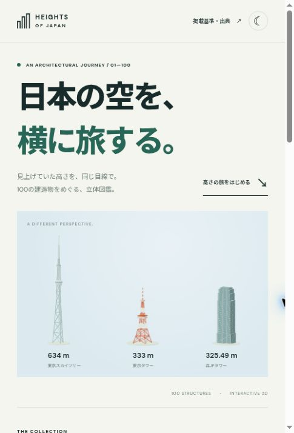

# HEIGHTS OF JAPAN

日本の高い建造物100件を、横スクロールと回転できる3Dモデルで巡る静的ウェブサイト。



## 機能

- 全100件の簡略3Dモデル。高さ順の横スワイプ、前後移動、位置スライダー
- 同じ縮尺での高さ比較／一棟ずつ拡大
- 3D回転、拡大ダイアログ、自動回転、昼夜切り替え
- 建造物名・場所の検索、種類・都道府県の絞り込み、100件の一覧
- 各施設の短い紹介、階数・年・出典・高さの基準
- iPhone対応、キーボード操作、reduce motion対応
- Three.js同梱。3D描画・データの外部CDN依存なし（書体のみGoogle Fonts、失敗時はシステム書体）

## データの範囲と限界

2026-11-01時点の公開資料に基づいて選定した主要100施設の高さ順。**全国の全工作物を網羅した確定TOP100ではありません。** 風車・ダムは対象外。ビル・塔・橋の主塔・煙突等を対象に、同一施設の複数主塔や煙突は原則まとめ、独立したビルは別棟で数えます。選定母集団と測定基準はサイト内「掲載基準と出典」に明記。

一覧資料の数値を基礎に、主要施設と2026年竣工物件などを一次資料で補いました。全100件の一次確認は未完了。該当施設には注記を表示。橋の海面基準高と他の地上高、ビルの建築高さと屋上通信塔込みの最高部が混在するため、各詳細に基準を表示しています。

データは `data.json`。順位は未丸めの掲載値で計算し、同高は同順位。年不明はnull。3Dは独自の模式表現で、幅・奥行き・窓・色を実測したモデルではありません。建物形状に応じたタイプ別モデルをパラメータ化しています。

主な資料：
- [日本の超高層建築物・構築物の一覧](https://ja.wikipedia.org/wiki/日本の超高層建築物・構築物の一覧)
- [List of tallest structures in Japan](https://en.wikipedia.org/wiki/List_of_tallest_structures_in_Japan)
- [東京スカイツリー公式](https://www.tokyo-skytree.jp/about/spec/)
- [三井不動産・日本橋竣工発表](https://www.mitsuifudosan.co.jp/corporate/news/2026/1008_01/)
- [NICT・標準電波](https://www.nict.go.jp/sts/jjy.html)
- 個別の出典は `data.json` の `sources` に保存。紹介文と3D表現は独自作成。

## GitHub Pages

`.github/workflows/pages.yml` が main の更新時に静的ファイルを検証・公開します。初回、Pages設定の有効化に失敗した場合は、リポジトリの Settings → Pages → Source を **GitHub Actions** に設定し、Actionsからワークフローを再実行してください。

## ローカル

HTTP静的サーバーでルートを配信してください。ビルド・npm installは不要。

```sh
python3 -m http.server 8000
```

検証：`npm run check`。

Three.js r160.1 (MIT)を `vendor/` に同梱。ライセンスは `vendor/LICENSE.txt`。
